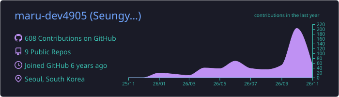
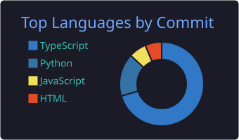

<h1 align="center">이승열 (maru)</h1>

<i>Leben wie ein Märchen</i>

  
  
  

웹 퍼블리셔로 4년 11개월 일했고, 반복되는 작업을 도구로 바꾸는 개발자로 넘어가는 중입니다.

## 대표 프로젝트

### WEAVE: 퍼블리싱 스타터 키트

> Tailwind를 쓸 수 없는 PHP·Java 환경에서, 프로젝트마다 반복하던 세팅을 없애려고 만든 CSS 유틸리티와 JS 플러그인 라이브러리

- **문제**: 프로젝트마다 reset.css, base.css, JS 공통 구조, 라이브러리 세팅, 자주 쓰는 기능을 새로 만들었음
- **해결**: 사내 클래스 네이밍의 CSS 유틸리티를 설계하고, 탭·모달·폼 검증 같은 기능을 JS 모듈로 만들어 불러오기만 하면 쓰게 함
- **결과**: 회사 프로젝트 최소 5개에 적용. 문서 사이트와 저장소로 정리함
- **한계**: 문서는 퇴사 직전에야 정리했음. 만들면서 같이 썼어야 했음
- [저장소](https://github.com/maru-dev4905/Weave) · [문서](https://weavekit.kr)

### MeerKit: AI 서비스 스타터킷 (구름 부트캠프, 3인 팀)

> 환경변수, Docker, 프론트·파이썬 의존성을 따로 설치하던 셋업을 `npx create-meerkit` 한 줄로 줄이는 스타터킷

- **문제**: AI 서비스를 시작할 때마다 셋업이 여러 단계로 흩어져 있었음
- **해결**: CLI 명령 10개 이상으로 통합. 실패하면 원인과 해결 방법을 같이 출력함. 에러 원인은 Always/Never 규칙으로 기록하는 개발 하네스를 만듦
- **맡은 일**: 프론트엔드, Claude 하네스, CLI 패키징
- **한계**: 규칙이 같은 실수를 줄였는지는 아직 측정하지 못함. Windows 실제 기기 검증은 진행 중
- [저장소](https://github.com/SNACKCUP/meerkit) · [npm](https://www.npmjs.com/package/@snackcup/meerkit)

## 쓰는 기술

  
  
  
  
  
  
  
  
  
  
  
  

## GitHub 활동

  
  

